# Journeys UI Review — Tablet & Mobile

**Date:** 2026-11-09
**Scope:** Journeys list (`/admin/journeys/`) and journey detail / new-journey pages (`/admin/journeys/{id}/`, `/admin/journeys/new/`)
**Code reviewed:** `templates/journeys-table.js`, `templates/template-journey-details.php`, `templates/journey-details.js`

## Method

The "Proposed" images are static HTML mockups in [`mockups/mockups.html`](mockups/mockups.html) (open with `?s=<screen>`). They use real journey data from dtplayground and show direction, not final visual design.


Screenshots were captured on dtplayground with headless Chromium, with touch enabled, at three viewports:

| Label | Viewport | Represents |
|---|---|---|
| Phone | 375 × 812 (mobile emulation) | iPhone 12–15 class |
| Tablet portrait | 768 × 1024 | iPad / 10" Android, portrait |
| Tablet landscape | 1024 × 768 | iPad / 10" Android, landscape |

Touch-target sizes come from `getBoundingClientRect()` on the live page. The benchmarks are:

- **44 × 44 pt** — Apple Human Interface Guidelines
- **48 × 48 dp** — Material Design
- **24 × 24 px** — the WCAG 2.2 AA floor (2.5.8)

## Summary

1. **Touch targets are too small almost everywhere.** Most tappable controls are below 44px. Several are under 20px tall, including the row actions on tablet, the stage-card actions, the Back link and the "+N more" link.
2. **Key actions are hard to reach or easy to mis-tap.**
   - On phone, Stages (the most-used part of an existing journey) starts about 1,180px down the page.
   - Destructive actions sit next to common ones: Delete is directly under Duplicate, and Delete Journey sits right above Stages.
   - The Save-mode dropdown chevron is small enough that taps intended for it can trigger **Save** instead.
3. **Some interactions only work with a mouse.** Hidden values are only available in a hover tooltip, and stages can only be reordered by dragging.
4. **Navigation doesn't match what mobile users expect.** "Back" and the system back gesture leave the page instead of closing the stage editor, and the new-journey form has no unsaved-changes guard.

---

## 1. Journeys list

### Phone

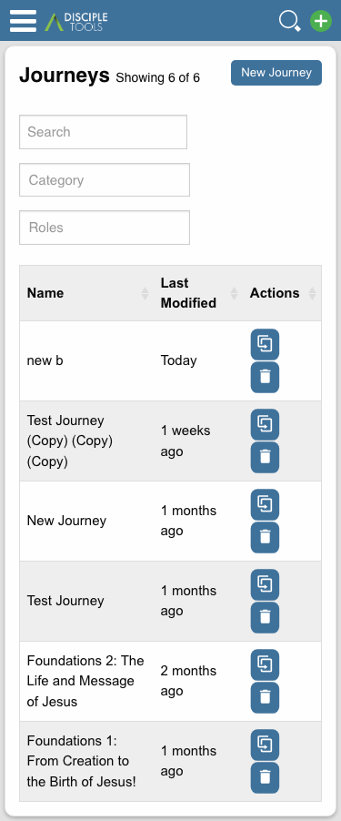

| Issue | Measured | Code |
|---|---|---|
| Duplicate and Delete are stacked about 4px apart. Delete has a confirm dialog, but Duplicate runs immediately with no feedback. | 32 × 34 each | `.icon-btn.mobile-button` |
| The three filter inputs stack vertically and use about 145px before any content shows. | 333 × 143 block | `.filter-inputs` |
| Only Name and Last Modified are visible, so there's no way to see category, roles or stage count. Sorting is only possible on the two visible columns. | — | `.mobile-hide` |
| The "New Journey" button is short. | 100 × 28 | `#create-button button` |
| Relative dates are ungrammatical ("1 weeks ago", "1 months ago") and not translatable. | — | date block in `render()` |

**Recommendations**

- **Replace the table with a card list below about 640px.** Each card shows:
  - the name in bold
  - category and stage count on a secondary line
  - roles (truncated) and the updated date on a tertiary line

  The whole card is the tap target, with at least 72px row height. This is the standard mobile list pattern in both Material and iOS.
- **Move secondary actions into a ⋮ menu** on each card that opens a bottom sheet with *Duplicate* and *Delete* (styled as destructive). This removes the adjacent-button mis-tap risk and declutters every row.
- **Collapse the filters.** Use one full-width search field plus a **Filters** button that opens a bottom sheet with Category, Roles and **Sort by**. Without column headers, the cards need their own sort control. Show active filters as removable chips under the search bar.
- **Give feedback on Duplicate.** Show a toast like "Copy created · Open · Undo". On touch devices, Undo works better than a confirmation dialog for non-destructive actions.
- Use `Intl.RelativeTimeFormat` for dates. It handles plurals and locale for free.

**Current vs. proposed:** card list, actions sheet, and Filter & sort sheet on phone

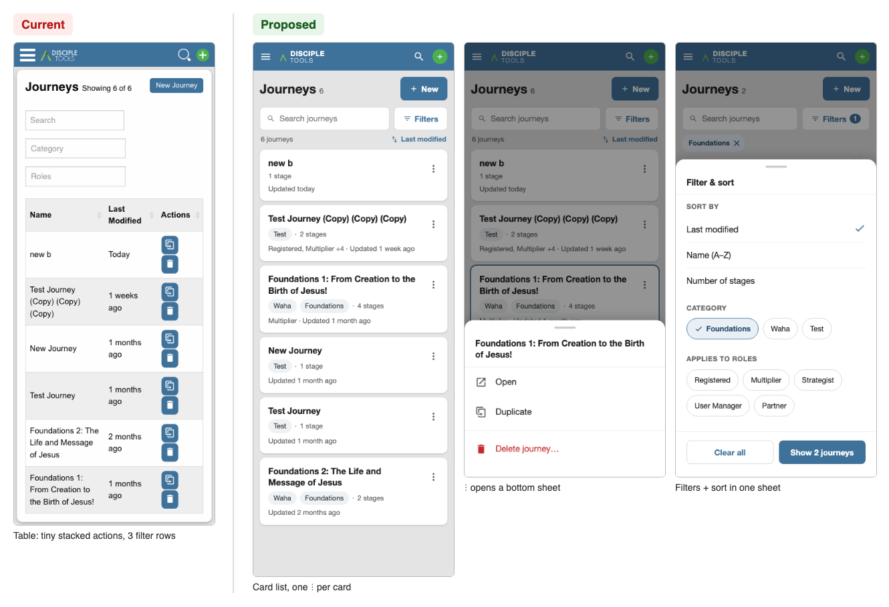


### Tablet portrait

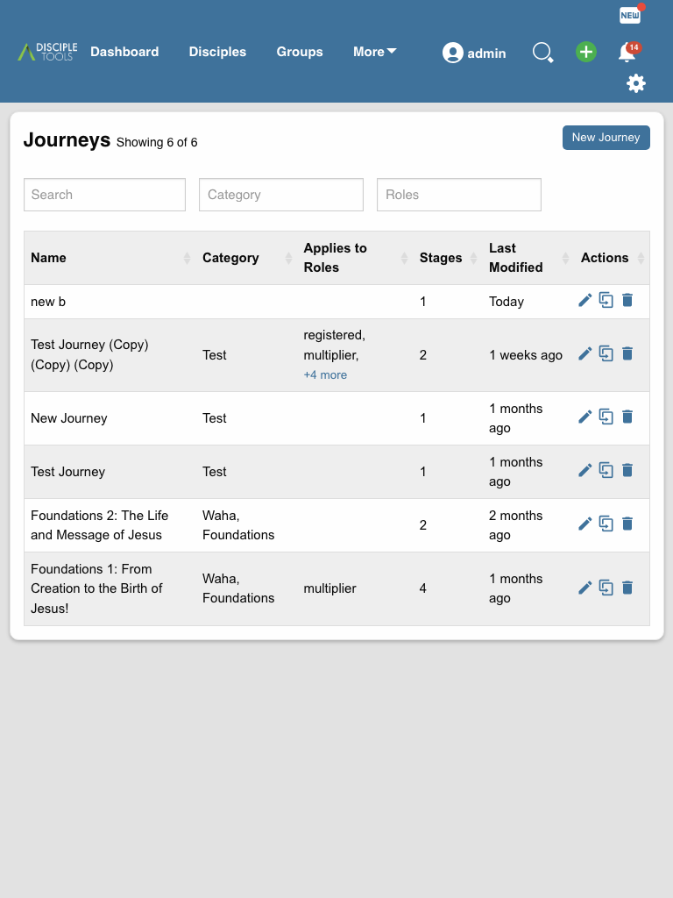

| Issue | Measured | Code |
|---|---|---|
| The edit, duplicate and delete icons are tiny and packed together. | **30 × 18** | `.icon-btn` |
| The list of extra roles behind "+4 more" is only in a hover `title` tooltip, which can't be seen on touch. | 50 × 20 | `.text-button` |
| Row heights vary from about 40px to 85px, and the shortest rows are below the 48px target. | — | `td` padding |

### Tablet landscape

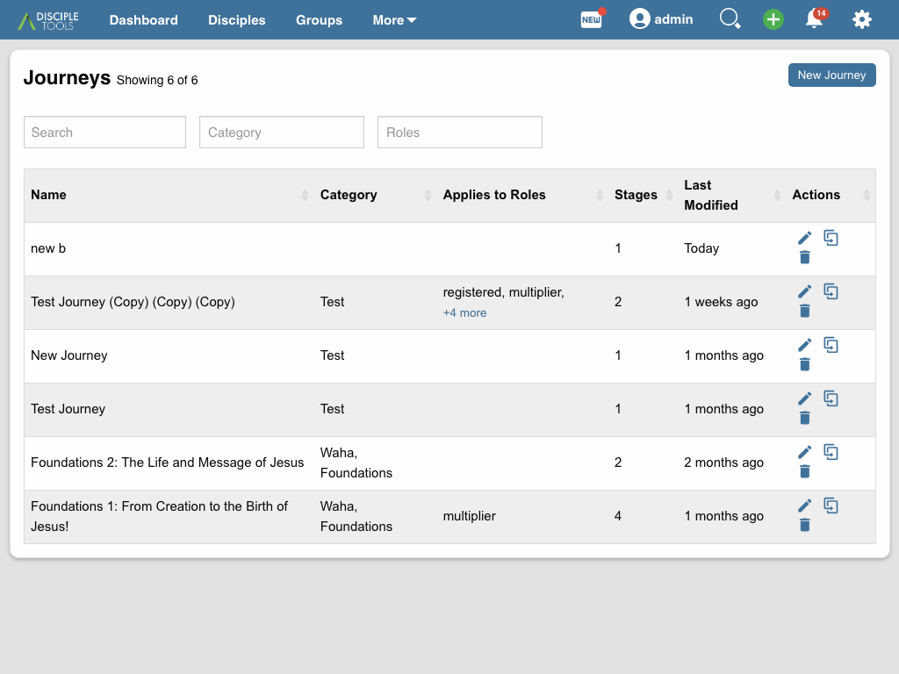

The Actions column wraps its three icons 2 + 1, which looks broken and leaves uneven targets of 40 × 18.

**Recommendations (tablet)**

- **Keep the table.** At these widths it's still the right pattern. But make every row at least 48px tall, and **replace the three icons with one ⋮ button** (at least 44 × 44) that opens a small menu. Tapping the row already opens the journey, so the pencil icon isn't needed. This also fixes the landscape wrapping.
- **In portrait, drop or truncate "Applies to Roles"** to a single line with a count (e.g. "Registered +5"). Make "+N more" expand inline on tap. The existing `toggleCell` already does this, so only the hover `title` reliance needs to go.
- Make "New Journey" at least 44px tall.

**Current vs. proposed:** tablet table with a single ⋮ per row, and a toast after Duplicate

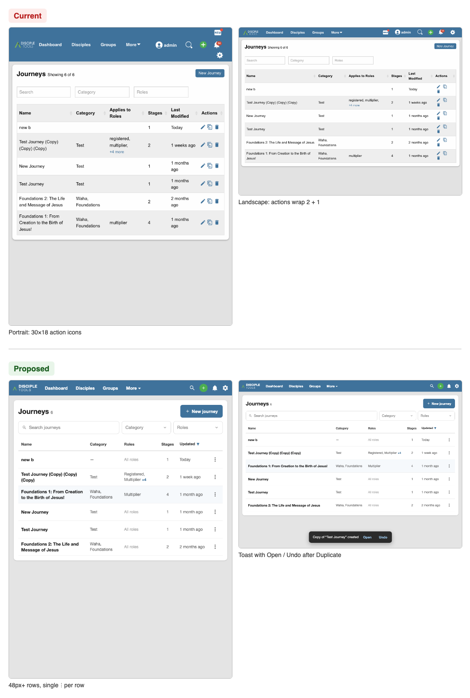


---

## 2. Journey detail — existing journey

### Phone

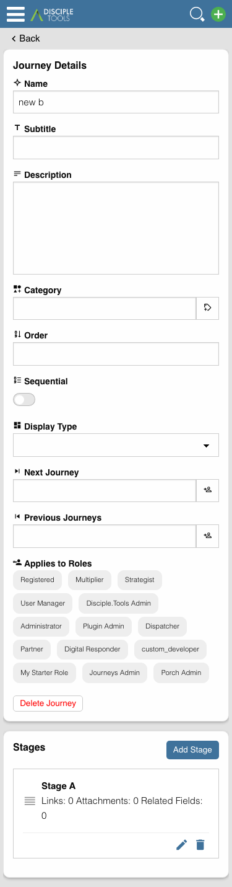

| Issue | Measured | Code |
|---|---|---|
| **Stages start about 1,180px down the page**, below ~14 fields and 14 role chips. For an existing journey, editing stages is usually the main task. | Stages section y ≈ 1179 | `#section-stages-list` |
| **Delete Journey is in the scroll path** right above Stages, where a mis-tap is likely during a fast scroll-and-tap. The confirm dialog limits the damage. | — | `.button-delete` |
| The Back link is tiny. | 60 × 19 | `.title .link-button` |
| The stage card's edit and delete icons are small. On phone they get their own divider row, which makes every card taller. | 45 × 20 | `#stage-list .icon-btn` |
| The drag handle is the only way to reorder stages. | 23 × 23 | `.drag-handle` |
| "Links: 0 Attachments: 0 Related Fields: 0" is noisy, wraps, and is hard-coded English. | — | `.stage-fields` |
| The role chips are about 26px tall and closely spaced. | — | theme `dt-multi-select` button group |

#### Stage editor on phone

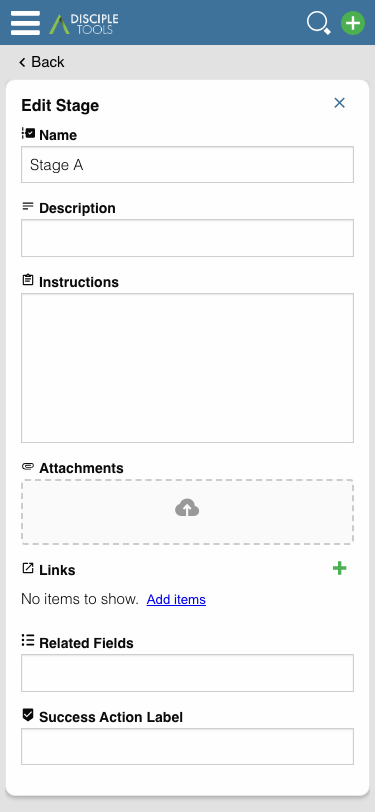

- **Back goes to the wrong place.** The only exit is a small ✕ in the corner. The "Back" link above it goes to the **journeys list**, not back to the journey.
- **The back gesture leaves the page.** Opening the editor doesn't add a history entry, so the Android back gesture or button, and the iOS edge swipe, also leave the page entirely.
- **There's no save feedback in the editor.** For an existing journey, edits auto-save through `ComponentService` and the Save/Cancel bar is hidden (`#stage-save-container` is `display: none`). The only "saved" checkmark appears next to the Stages heading, which is hidden while the editor is open. Users can't tell whether their work is saved.

### Tablet portrait

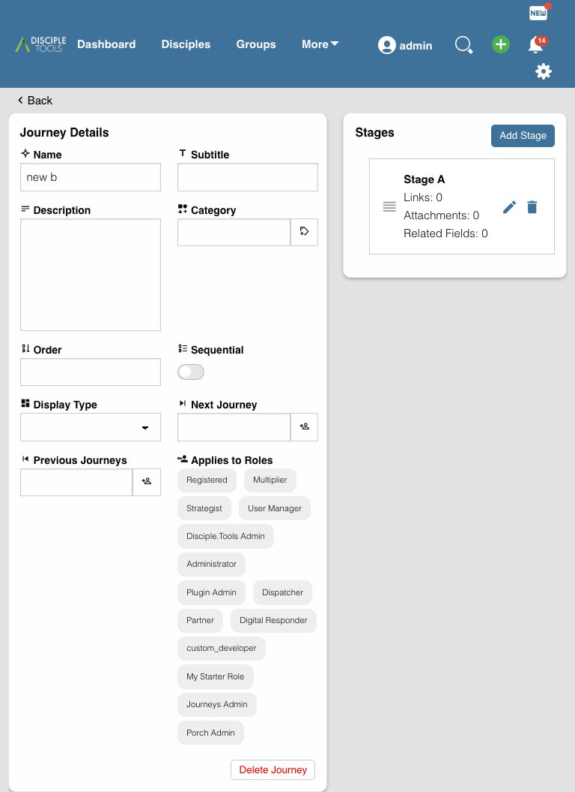

- The two-column field grid leaves each input only about 190px wide inside a 427px panel. Description pairs awkwardly with Category, and the long roles list pushes the panel far below the stages panel.
- The Stages column is only 299px wide, so each stage's counts line wraps over three lines.
- Delete Journey is below the fold at the very bottom.

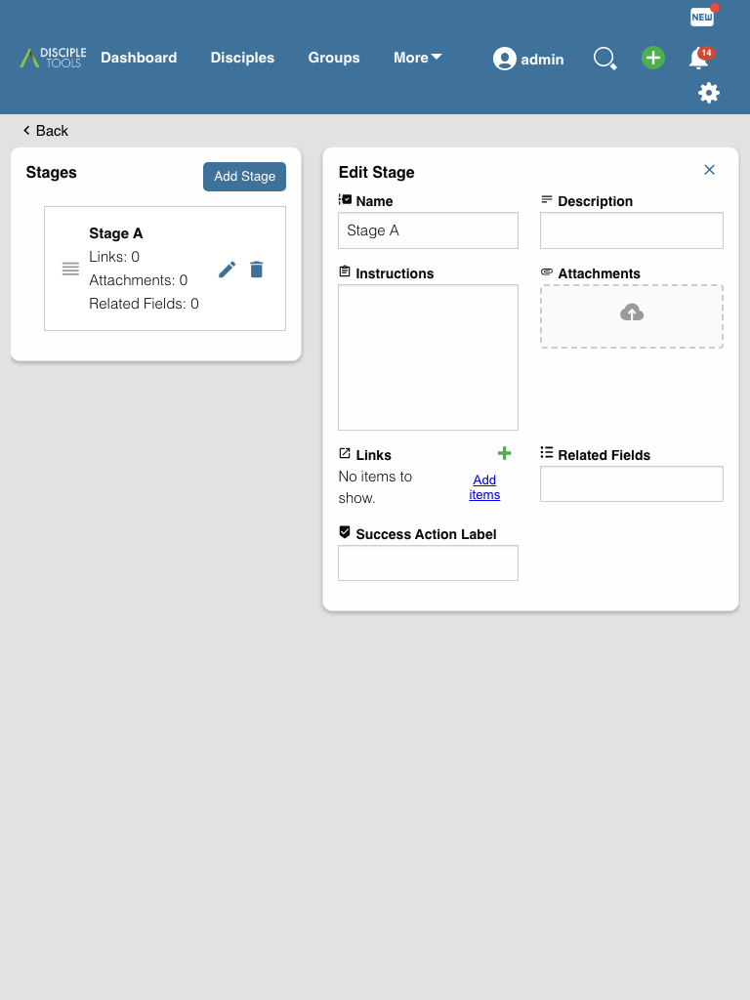

The stage editor slides in correctly, but the form is again cramped into two columns at about 190px each. Links shows "No items to show. Add items" squeezed onto two lines.

### Tablet landscape

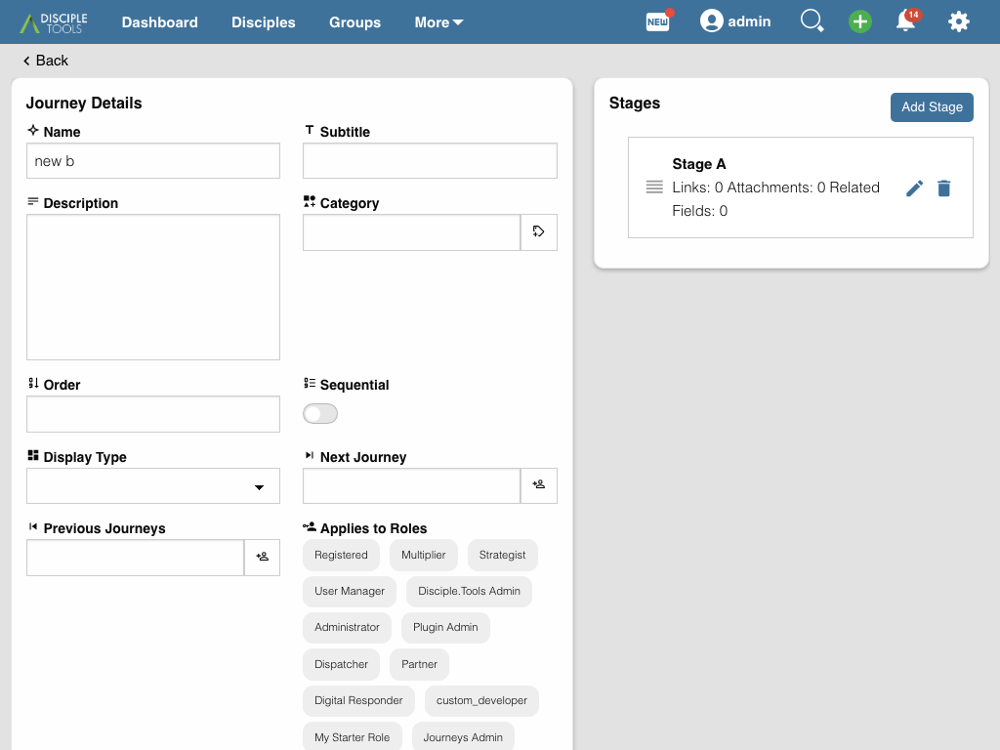

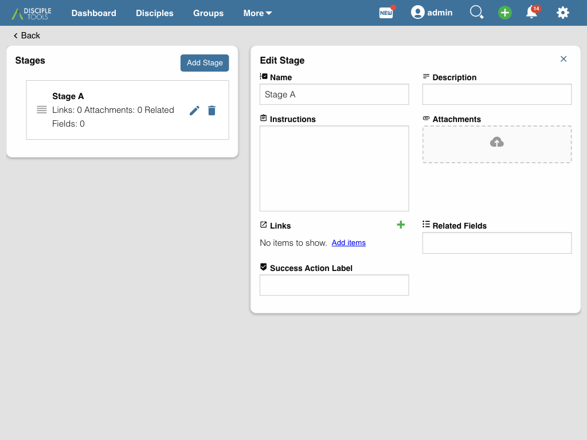

**This works well.** The list-and-detail layout, with the stage list on the left and the editor sliding in on the right, is the right pattern for this width. Keep it. Only the target sizes and the stage-card text need work here.

**Current vs. proposed:** landscape keeps the side-by-side layout, adding numbered stages, a selected state, and a Saved + Done editor header

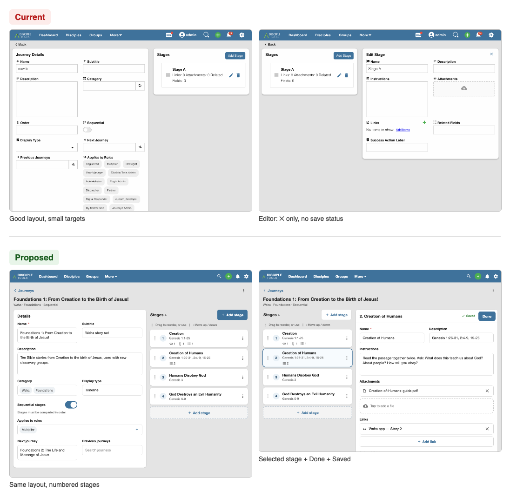


### Recommendations (detail page)

1. **Phone and tablet portrait: add a two-tab switch at the top of the page, "Details | Stages (n)".**
   - Open existing journeys on *Stages* and new journeys on *Details*.
   - This removes the 1,200px scroll, gets Delete out of the scroll path, and keeps both halves one tap apart.
   - Keep the current side-by-side layout from about 1024px and up.
2. **Move "Delete Journey"** into a ⋮ menu in the page header, or into a clearly separated danger section at the very bottom of the Details tab. Don't leave it between content areas.
3. **Make the stage editor a real navigation step.**
   - Call `history.pushState` when opening the editor, or route to `/admin/journeys/{id}/stages/{stageId}`, and handle `popstate` to close it. Back and the swipe gestures then do what users expect.
   - Rename or retarget the top "Back" link so it closes the editor first.
   - Replace the ✕ with a labelled **Done** button, at least 44px tall, at the top right, plus a sticky bottom bar on phone.
   - Show an inline "Saving… / Saved" status inside the editor header for auto-saved edits.

   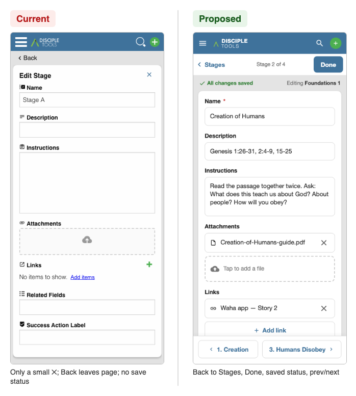
4. **Stage cards**
   - Make the whole card tappable to open the editor, and move Delete into a ⋮ menu or a swipe action. That removes the separate action row on phone.
   - Replace "Links: 0 Attachments: 0 Related Fields: 0" with small icon + count badges, hide zero counts, and make them translatable.
   - Show the stage number (1, 2, 3…) on each card so the order is clear without dragging.
5. **Reordering**
   - Enlarge the drag handle hit area to at least 44 × 44. The icon can stay small inside a padded button.
   - Add a non-drag alternative: *Move up / Move down* in the card's ⋮ menu, or a "Reorder" mode with ▲▼ buttons. WCAG 2.2 (2.5.7, Dragging Movements, level AA) requires a single-pointer alternative, and it's also easier for one-handed phone use.
6. **Field layout**
   - Replace the fixed `repeat(2, 1fr)` grid with `repeat(auto-fit, minmax(280px, 1fr))`, so the layout adapts to the panel width rather than the viewport.
   - Make Description, Instructions, Links and Applies to Roles span the full width (`grid-column: 1 / -1`).
   - Tablet portrait then gets one comfortable column where needed instead of cramped pairs.

**Current vs. proposed:** tablet portrait with tabs and an auto-fit field grid

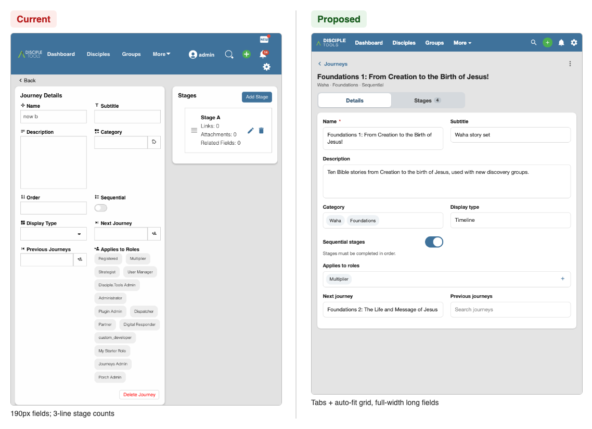

7. **Role chips** (theme web component, `dt-multi-select` button group): on touch, aim for at least 40px chip height with 8px gaps, or switch to a searchable multi-select on phone. This change belongs in `disciple-tools-web-components`, not this plugin.

**Current vs. proposed:** Stages tab with numbered cards, the stage ⋮ menu with Move up / down, and the Details tab with Delete in the header menu

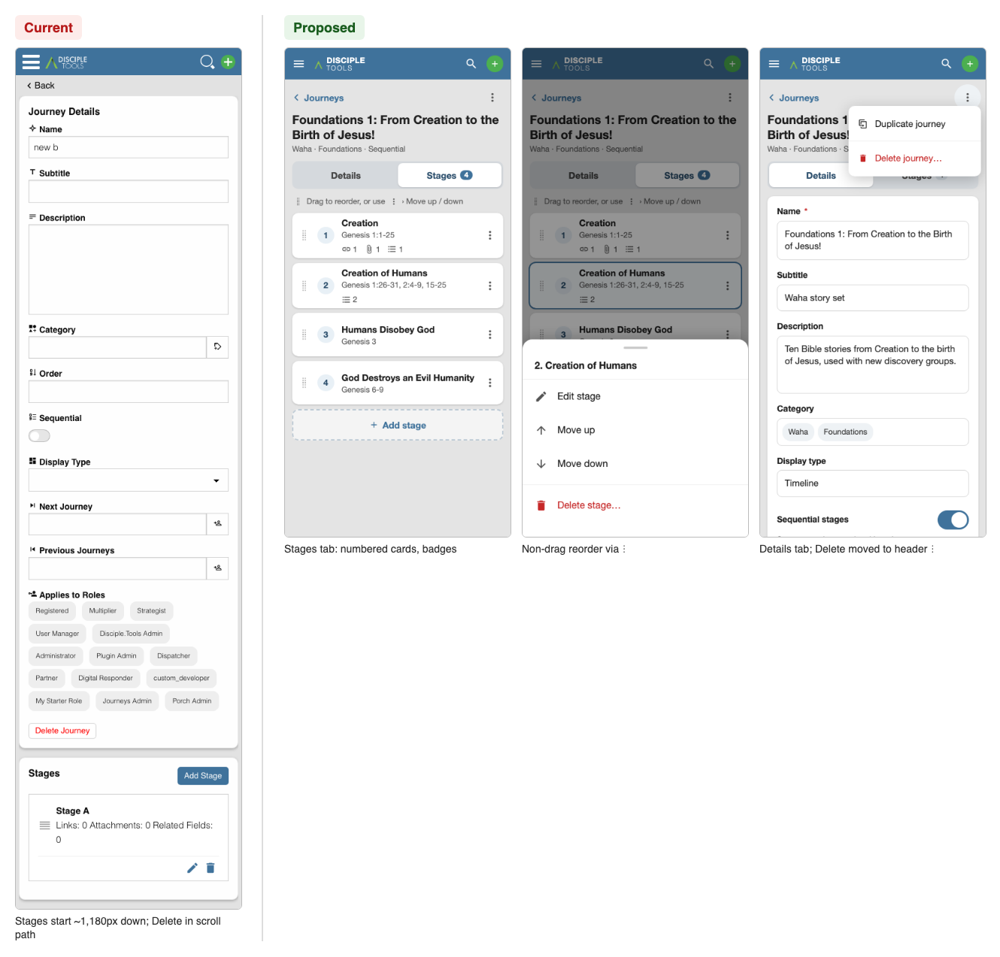


---

## 3. New journey

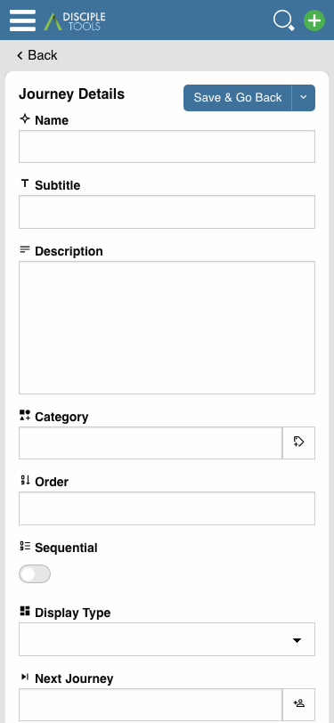

### Bug: the Save-mode dropdown is hard to open, and near-misses trigger Save

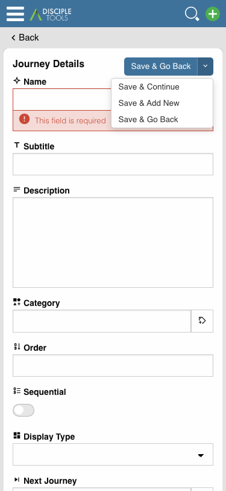

*The menu is open after tapping the chevron icon itself. The red "This field is required" error comes from an earlier tap near the chevron's edge, which was routed to **Save**.*

The split button has two problems on touch.

**1. Only the icon opens the menu.** `toggle_save_dropdown()` checks `event.srcElement.id === "top-icon"` / `"bottom-icon"`, so the menu only opens when the tap lands exactly on the 13.5 × 16 chevron icon. A tap anywhere else on the 26 × 30 toggle button does nothing.

**2. Near-misses trigger Save.** A tap 3px inside the toggle's left edge was delivered to `#save-btn` (Save & Go Back). Chrome's mobile touch adjustment snaps a finger-sized contact area to the most likely target, and the larger Save button wins. I captured this event sequence:

```
click: BUTTON#save-btn.button split-main-btn
invalid: journey_name
```

With an empty form, validation stops the submit. **With a filled-in form, a user trying to change the save mode would instead save and be sent back to the list.**

This was reproduced in Chrome's mobile touch emulation. Real devices use similar touch adjustment, so expect the same behaviour on phones and tablets.

**Fixes**

- In `toggle_save_dropdown`, use `event.currentTarget` (or `closest('.split-wrapper')`) rather than `event.srcElement.id`. Give each wrapper a unique id; `#save-split-button` and `#save-btn` are currently duplicated.
- Make the toggle button at least 44 × 44 and add visible spacing from the main button.
- Better still on phone, **drop the split button**:
  - Use a single **Save** button in a sticky bottom bar, within thumb reach.
  - After saving, stay on the journey (the current "Save & Continue" behaviour) and show a toast with "Add another".
  - The current mode is remembered in `localStorage` (`dt_journey_save_action`), so the button's label and behaviour can change between visits without the user noticing. That's especially confusing when the menu is hard to open on touch.

### Unsaved work can be lost

On a new journey, stages are kept only in memory (`window.stages`) until the journey is saved. The Back link, the system back gesture, or an accidental tap on the site nav discards everything without warning. Add a `beforeunload` guard and an in-app "Discard changes?" confirmation on the Back link while the form or stage list has unsaved changes.

**Current vs. proposed:** sticky Save bar and the unsaved-changes dialog

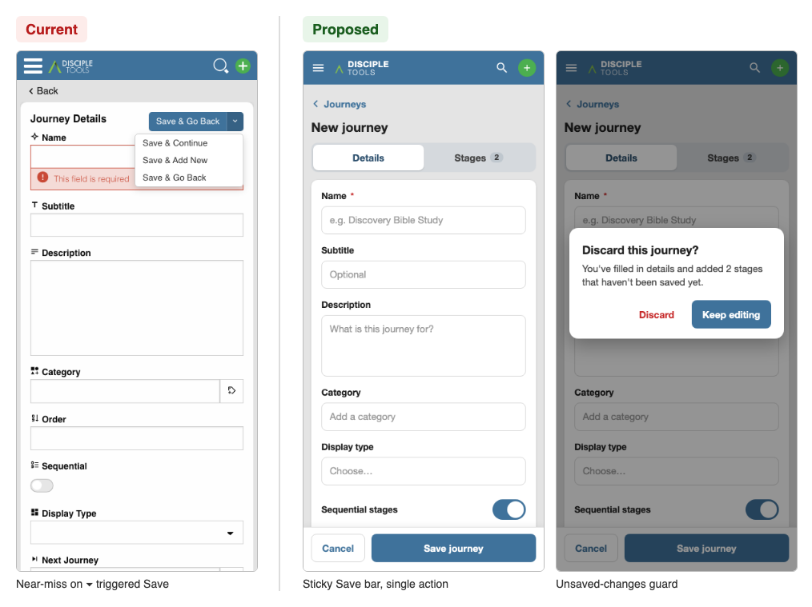


---

## Touch-target summary

| Control | Phone | Tablet | Target |
|---|---|---|---|
| List row actions (edit/duplicate/delete) | 32 × 34 | 30–40 × **18** | 44 × 44 |
| New Journey button | 100 × 28 | 100 × 28 | ≥ 44 tall |
| "+N more" | — | 50 × 20 | ≥ 44 tall, or the whole cell |
| Back link | 60 × 19 | 60 × 19 | 44 × 44 |
| Add Stage | 85 × 30 | 85 × 30 | ≥ 44 tall |
| Stage edit/delete icons | 45 × 20 | 45 × 20 | 44 × 44, or the whole card |
| Stage drag handle | 23 × 23 | 23 × 23 | 44 × 44 hit area |
| Save-mode toggle (effective) | **13.5 × 16** | 13.5 × 16 | 44 × 44 |

## Suggested order of work

1. **Fix the split-button toggle** (`currentTarget`, larger target, spacing). Small change, and it removes the accidental-Save risk.
2. **Enlarge touch targets** across both pages and replace per-row icon clusters with a single ⋮ menu.
3. **Make the stage editor work with Back**, add a **Done** button and an inline save status, and add an unsaved-changes guard on new journeys.
4. **Add the Details / Stages tabs** on phone and tablet portrait, and move Delete Journey out of the scroll path.
5. **Switch the list to cards on phone**, with filters and sort in a bottom sheet.
6. **Add a non-drag way to reorder stages**, plus stage numbers on cards.
7. Polish: an `auto-fit` field grid, badge-style stage counts, `Intl.RelativeTimeFormat`, and translatable strings.

### Out of scope / upstream

- On tablet portrait, the theme's top nav wraps the settings icon onto a second row, which pushes all content down about 70px. This is in `disciple-tools-theme`.
- The role chip sizing belongs in `disciple-tools-web-components`.
